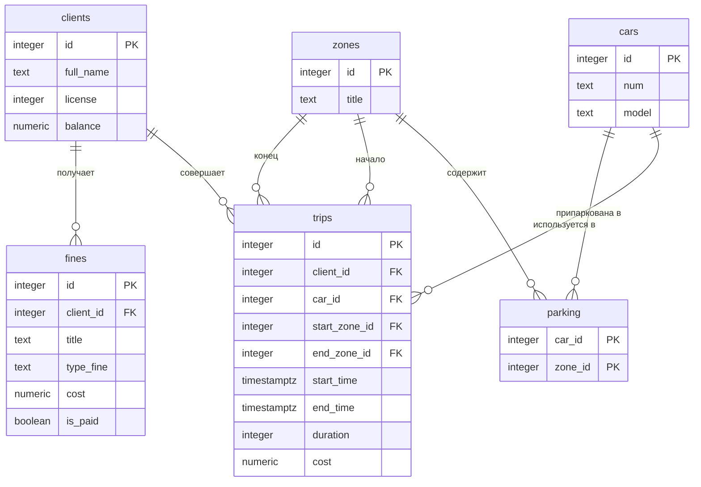

Тема № 21: Каршеринг. 
Клиенты-водители берут машину в аренду. У каждой машины есть порядковый номер, модель, зона парковки, где она оставлена, стоимость аренды в минуту. Цена поездки зависит от времени поездки. Машину можно взять/оставить только в зонах парковки. У клиента-водителя есть свой аккаунт, в котором отображается его id, ФИО, права, баланс, штрафы, история поездок. Поездку можно начать только с положительным балансом. При нарушениях правил водитель-клиент может получить штраф.  

|--- | --- |--- |
| Главная таблица | Поездки |
| Связь N:M | Машины и Зоны через `Парковка` |
| Бизнес-правило | Поездка только при положительном балансе |
| СУБД | PostgreSQL 17 в Docker |

## Задания курса

Правила курса, установка и порядок сдачи: [docs/README.md](docs/README.md).

| Лаба | Задание |
| --- | --- |
| 1. Модель данных и схема | [docs/lab-1.md](docs/lab-1.md) |
| 2. Запросы | [docs/lab-2.md](docs/lab-2.md) |
| 3. Логика в базе | [docs/lab-3.md](docs/lab-3.md) |
| 4. Транзакции и доступ | [docs/lab-4.md](docs/lab-4.md) |
| 5. Производительность | [docs/lab-5.md](docs/lab-5.md) |
| Витрина к защите | [docs/showcase.md](docs/showcase.md) |

## Как запустить

```bash
cp .env.example .env          # пароли и порт
docker compose up -d          # при первом запуске выполняются скрипты из db/
dbcheck run demo/lab1.sql     # сценарий лабы 1
```

Работа с базой: `docker compose exec db psql -U postgres -d app`. Сценарии выполняются в `psql` командой `\i /demo/lab1.sql`.

После изменения скриптов в `db/` базу нужно пересоздать: `docker compose down -v && docker compose up -d`.
## Нормализация
Исходная таблица
| --- | --- |--- | --- |--- | --- |--- | --- |--- | --- |--- | --- |--- | --- |
| trip_id | client_name | client_license | client_balance |	car_number | car_model | start_zone_name | end_zone_name | start_time | end_time | trip_cost | fine_name | fine_type | fine_cost
| 1 | Иван И. |	1234 | 5000 | A123BC | Toyota | Центр |	Север |	2026-10-01 10:00 | 2026-10-01 | 10:30 | 300	| Превышение | Админ | 500 |
| 2	| Иван И. | 1234 | 5000 | B456CD | Kia | Север | Центр | 2026-10-02 12:00 | 2026-10-02 12:45 | 450 | NULL | NULL | NULL |
| 3	| Петр П. | 5678 | 2000 | A123BC | Toyota | Центр | Юг | 2026-10-03 09:00 | 2026-10-03 09:20 | 200 | NULL | NULL | NULL |
| 4	| Иван И. | 1234 | 5000 | A123BC | Toyota | Юг | Центр | 2026-10-04 15:00 | 2026-10-04 15:40 | 400 | Парковка | Внутр | 300 |

Проблемы этой таблицы:
| --- | --- |
|Дублирование:| Данные клиента (client_name, client_license, client_balance) повторяются для каждой поездки. Данные машины (car_model) повторяются.|
| Проблемы обновления:| Если Иван сменит права, придется обновлять все его строки. Если обновить только одну — база будет противоречивой.|
| Проблемы вставки: | Нельзя добавить нового клиента, пока он не совершит поездку.|
| проблемы удаления:|Если удалить все поездки Ивана, мы потеряем информацию о самом клиенте. |
| Смешивание сущностей: | Штрафы (fine) и поездки (trip) — это разные сущности. В одной строке они могут конфликтовать (у поездки без штрафа поля штрафа будут NULL). |

| --- | --- |
|1НФ: | в каждой ячейке одно значение, без списков через запятую.
    уже выполняется|
| 2НФ: | каждый неключевой столбец зависит от всего ключа, а не от его части.
    Первичный ключ — trip_id. Все атрибуты поездки зависят от него. Но client_name зависит не от trip_id, а от client_id (которого пока нет). Это частичная зависимость. Чтобы исправить это, мы выносим клиентов в отдельную таблицу clients.|
| 3НФ: | неключевые столбцы не зависят друг от друга.

    В таблице clients client_name зависит от client_id (PK). Но в исходной таблице car_model зависит от car_number, а car_number зависит от trip_id. Это неверно: trip_id -> car_number -> car_model. Выносим машины в таблицу cars.
    Аналогично, start_zone_name зависит от start_zone_id, а не от trip_id. Выносим зоны в zones.
    Штрафы (fines) — это отдельная сущность, которая зависит от клиента, а не от поездки. Выносим их в отдельную таблицу.
    Парковка (parking) — это связь многие-ко-многим между машинами и зонами. Выносим в отдельную таблицу.| 

Итоговая схема (3НФ)
| --- | --- |
    |clients| хранит данные клиента. client_name и license больше не повторяются в поездках. |
    |cars | хранит данные машины. model не повторяется в поездках. |
    |zones | справочник зон. Названия зон не дублируются в поездках и парковках. |
    |trips | содержит только факты поездок (кто, на чем, откуда, куда, когда, сколько). Ссылается на clients, cars, zones через FK. |
    | fines | содержит только штрафы. Ссылается на clients. |
    | parking | связующая таблица для машин и зон. |

## ER-диаграмма



## Ограничения

| Ограничение | Таблица и колонки | Зачем |
| --- | --- | --- | 
| `NOT_NULL` | clients.full_name | Водитель должен иметь ФИО |
| `NOT_NULL` | clients.license | Водитель не может арендовать машину без водительского удостоверения |
| `UNIQUE` | clients.license | Водительское удостоверение не может быть одинаковым у разных людей |
| `CHECK (balance >= 0)` | clients.balance  | Баланс не может быть отрицательным |
| `NOT_NULL` | clients.balance  | Баланс не может отсутствовать |
| `UNIQUE` | cars.number | Номер машины должен быть уникальный |
| `NOT_NULL` | cars.number | Машина не может быть без номера |
| `NOT_NULL` | cars.model | У машины не может отсутствовать модель |
| `NOT_NULL` | zones.name | Зона парковки обязательно должна быть |
| `UNIQUE` | zones.name | Название зоны парковки не должно повторяться |
| `NOT_NULL` | fines.client_id | Штраф должен указывать кем он получен |
| `NOT_NULL` | fines.type name | Тип штрафа, название обязателен |
| `NOT_NULL` | fines.cost | Штраф обязательно имеет сумму|
| `CHECK (cost >0)` | fines.cost | Стоимость штрафа положительная |
| `NOT_NULL` | fines.is_paid | Статус погашения должен быть |
| `DEFAULT false` | fines.is_paid | штраф по умолчанию не может быть погашен погашен |
| `NOT_NULL` | trips.client_id, trips.car_id, trips.start_zone_id, trips.end_zone_id, trips.start_time | Клиент, машина, точка старта и конца, время старта не могут быть пустыми при оформлении поездки | 
| `CHECK (cost >= 0)` | trips.cost | Цена поездки обязательно положительная |
| `CHECK (type_fine IN ('administrative', 'internal'))` | fines.type_fine | Тип штрафа выбирается из имеющихся |
| `CHECK (end_time > start_time)` | trips.end_time , trips.start_time | Окончание поездки должно быть позже начала |

## Поведение при удалении
| Связь | Выбранное поведение | Причина |
| --- | --- | --- | 
| fines.client_id -> clients.id | ON DELETE CASCADE | При полном удалении клиента из системы история его штрафов теряет смысл, а значит должна очищаться автоматически. |
| trips.client_id -> clients.id | ON DELETE RESTRICT | Нельзя удалить клиента, если у него есть история совершенных поездок (необходимо для отчетности). |
| trips.car_id -> cars.id | ON DELETE RESTRICT | Запрещено удалять автомобиль, если он фигурирует в поездках, для избежания потери аналитики. |
| trips.start_zone_id -> zones.id | ON DELETE RESTRICT | Нельзя удалить зону, если она является точкой отправления в существующих поездоках. |
| trips.end_zone_id -> zones.id | ON DELETE RESTRICT | Нельзя удалить зону, если она зафиксирована как точка финиша поездки. |
| parking.car_id -> cars.id | ON DELETE CASCADE | Таблица отображает текущее состояние. Если машина полностью удаляется, запись о её текущем местоположении должна исчезнуть. |
| parking.zone_id -> zones.id | ON DELETE RESTRICT | Системе запрещено ликвидировать зону, пока внутри неё физически припаркована хотя бы одна машина.|

## Что сделано по лабам

| Лаба | Что сделано | Сценарий |
| --- | --- | --- |
| 1 | ... | `demo/lab1.sql` |
| 2 | ... | `demo/lab2.sql` |
| 3 | ... | `demo/lab3.sql` |
| 4 | ... | `demo/lab4.sql`, `demo/race.sql`, `demo/race_fixed.sql` |
| 5 | ... | `demo/lab5.sql` |

<!--
  Разделы, которые добавляются по ходу курса:
  лаба 1 ★: «Нормализация», «Типы данных»; ★★: «Что происходит при удалении»;
  лаба 4: «Гонка»;
  лаба 5: «Производительность» (таблица до / после, когда индекс не помогает, размеры).
-->
